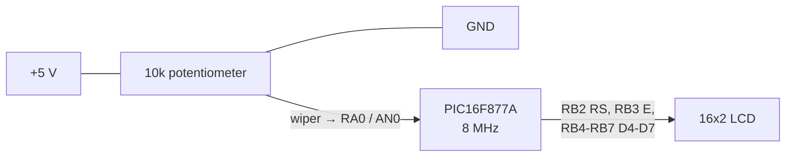
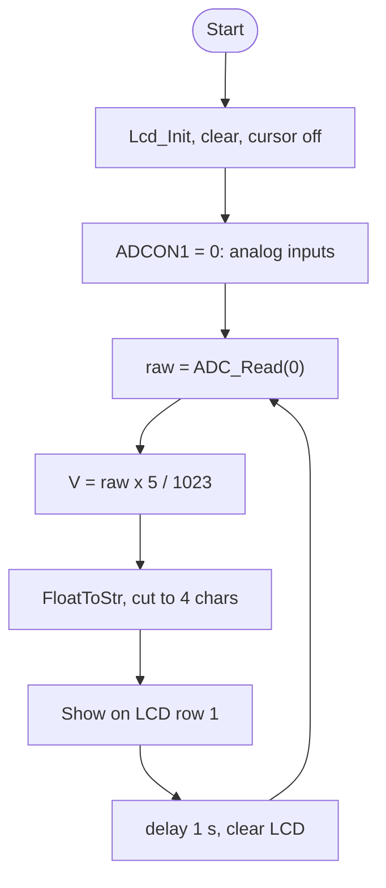

# Microcontroller-Potentiometer-Voltmeter

A simple **0–5 V voltmeter**: the PIC16F877A reads a potentiometer on analog channel **AN0**, converts the 10-bit ADC value to volts, and shows it on a 16×2 LCD once per second.

## Target hardware & settings

| Setting | Value |
|---|---|
| Microcontroller | **PIC16F877A** (10-bit ADC) |
| Clock | 8 MHz crystal (HS) |
| Compiler / IDE | mikroC PRO for PIC (`Lcd`, `ADC`, `Conversions` libraries) |
| ADC reference | VDD (5 V) / VSS, set by `ADCON1 = 0`, which makes all AN pins analog |
| Config word | `0x2F4A`: HS oscillator, WDT off, PWRT off, BOR on, LVP off, no code protection |

## Wiring

| Signal | Pin |
|---|---|
| Potentiometer wiper | RA0 / AN0 |
| LCD RS / E / D4–D7 | RB2 / RB3 / RB4–RB7 |

## How the code works (`volt.c`)

1. Sets up the LCD (clears it and hides the cursor).
2. `ADCON1 = 0b00000000` makes PORTA/PORTE analog inputs with VDD as the reference.
3. Loop:
   - `tmp = ADC_Read(0)` reads a raw value from 0 to 1023 on AN0.
   - `tmp = tmp * 5 / 1023` converts it to volts as a float.
   - `FloatToStr(tmp, txt); txt[4] = 0;` turns it into text and keeps 4 characters, e.g. `2.47`.
   - `Lcd_Out(1,1,txt)` shows it, then the loop waits 1 s and clears the LCD.

**Formula:** `V = ADC × 5 V / 1023`, so one step ≈ 4.9 mV.

## Build & flash
Open `volt.mcppi` in mikroC PRO for PIC, build, and flash `volt.hex`.
